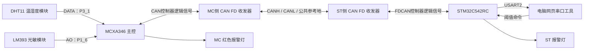

# 基于 MCXA346 与 STM32C542RC 的 CAN FD 环境监测与双端报警系统

> 本文根据项目开发记录及当前源码整理，说明项目定位、功能、硬件连接和软件框架。  
> 文档日期：2026 年 10 月 30 日。  
> 下文将 MCXA346 主控端简称为 **MC**，将 STM32C542RC 协作端简称为 **ST**。

## 一、项目概述

本项目采用 MCXA346 与 STM32C542RC 双控制器架构，实现环境数据采集、CAN FD 双向通信、阈值报警及网页串口监控。

MCXA346 作为主控，运行 RT-Thread，负责读取 DHT11 温湿度和 LM393 光敏模块的模拟输出，将采集结果发送至 ST。ST 接收并解析数据，与本端阈值比较，控制报警 LED，并将报警状态通过 CAN FD 回传。MC 再结合本端独立判断结果，决定是否点亮自己的报警灯。

电脑通过 ST 的 USART2 查看环境数据、修改 ST 阈值。配套网页串口工具提供实时数值、曲线、逐项超标提示和命令发送界面。

本项目的主要特点包括：

- 将传感器采集与接收端阈值判断分配到两个控制器。
- 通过 CAN FD 完成环境数据下发和状态回传。
- MCXA346 和 ST 独立判断，再由 MCXA346 对两端报警结果进行联合确认。
- 支持通过串口修改 ST 阈值，无需为每次阈值调整重新编译。
- 使用本地网页完成串口监控，便于展示与调试。

## 二、功能介绍

### 2.1 环境数据采集

| 采集对象 | 使用模块 | 接口 | 输出数据 |
| --- | --- | --- | --- |
| 温度 | DHT11 三针模块 | GPIO 时序通信 | 温度，单位 ℃ |
| 相对湿度 | 同一 DHT11 模块 | GPIO 时序通信 | 相对湿度，单位 %RH |
| 光敏信号 | 带 LM393 的光敏模块 | AO 接 ADC | raw，范围 0～65535 |

DHT11 与光敏模块均由 MCXA346 读取。当前光敏模块使用 AO，DO 未连接。

环境采样在上电初始化后自动启动，采样等待间隔为 2000 ms，实际周期还包含读取所需时间。DHT11 两次读取尝试之间至少间隔 2 秒。

驱动包含超时、校验和及数据范围检查。只有温湿度和光敏 AO 均有效的完整样本，才会进入供 CAN 发送使用的缓存；超过 5 秒的缓存不再作为新鲜数据使用。

光敏 raw 是 ADC 原始数值，不直接等同于照度 lux。当前串口打印只保留 raw，已去掉估算电压及相关括号说明。raw 增大对应更亮还是更暗，需要根据具体模块的输出方向确认。

### 2.2 CAN FD 双向通信

MCXA346 周期性发送最新有效环境样本。ST 解析后回传本端灯状态和超标项数。

| 参数 | 当前配置 |
| --- | --- |
| 帧类型 | CAN FD 标准数据帧，11 位标识符 |
| BRS | 启用 |
| 仲裁段速率 | 500 kbit/s |
| 数据段速率 | 2 Mbit/s |
| MC → ST 标识符 | 0x101 |
| ST → MC 标识符 | 0x102 |
| 单帧载荷 | 8 字节 |
| MC 等待有效状态回复 | 最长 1000 ms |
| 自动通信轮次间等待 | 1000 ms，另计发送及等待回复耗时 |

传感器采样和 CAN 通信分别运行，因此相邻发送轮次可能使用同一份有效缓存，并不代表每发送一帧就重新采集一次传感器。

状态回复包含请求序号和请求数据的 CRC32。MC 会校验帧属性、标识符、长度、序号、CRC32，以及灯状态和超标项数是否一致，避免将无关或过期回复用于控制报警灯。

### 2.3 ST 阈值报警

ST 分别判断温度、湿度和光敏 raw 是否**严格大于**阈值，至少两项超标时点亮报警灯。

| 参数 | MC 本地默认阈值 | ST 默认阈值 |
| --- | --- | --- |
| 温度 | 25 ℃ | 25 ℃ |
| 相对湿度 | 60 %RH | 60 %RH |
| 光敏 raw | 30000 | 30000 |

判断公式：

```text
超标项数 = (温度 > 温度阈值)
         + (湿度 > 湿度阈值)
         + (raw > raw阈值)

ST报警 = 超标项数 >= 2
```

等于阈值不计为超标。例如温度为 25 ℃、阈值为 25 ℃时，温度这一项属于正常。

在默认阈值下：

| 温度 | 湿度 | raw | 超标项 | ST 报警灯 |
| --- | --- | --- | --- | --- |
| 26 ℃ | 61 %RH | 20000 | 温度、湿度 | 亮 |
| 26 ℃ | 50 %RH | 31000 | 温度、光敏 raw | 亮 |
| 25 ℃ | 60 %RH | 30000 | 无 | 灭 |
| 26 ℃ | 50 %RH | 30000 | 仅温度 | 灭 |

没有有效样本时，ST 报警灯保持熄灭；有效运行过程中超过约 5 秒未收到有效 CAN 环境数据，ST 熄灯并打印超时提示。初始化失败时的错误指示属于另一种工作状态，不应当作正常阈值报警解释。

### 2.4 MC 与 ST 报警结果联合确认

MC 使用本地阈值，对本次发送的同一份样本独立比较，并结合 ST 回传的报警状态控制 MC LED：

```text
MC报警灯亮 = ST判断至少两项超标
          且 MC本地判断至少两项超标
```

| ST 报警判断 | MC 本地报警判断 | MC 报警灯 |
| --- | --- | --- |
| 未报警 | 未报警 | 灭 |
| 未报警 | 报警 | 灭 |
| 报警 | 未报警 | 灭 |
| 报警 | 报警 | 亮 |

两端的超标项数不必完全相同。例如 ST 为两项、MC 为三项，两端均达到报警条件，MC 灯仍然点亮。

缺少新鲜样本、CAN 发送失败或有效状态回复超时，会使 MC 报警灯熄灭。

**串口 SET 命令只修改 ST 阈值，不会同步修改 MC 阈值。** MC 阈值由源码中的宏定义配置。

### 2.5 串口阈值配置

ST 通过 USART2 提供查询、设置和帮助命令。

| 命令 | 功能 | 示例 |
| --- | --- | --- |
| GET | 查询 ST 当前阈值 | GET |
| SET | 设置温度、湿度、raw 三个阈值 | SET 28 65 35000 |
| HELP | 显示命令用法 | HELP |

SET 的三个参数均为整数：

- 温度：0～50，单位 ℃。
- 湿度：0～100，单位 %RH。
- raw：0～65535。

命令区分大小写，使用大写命令，并以 CR、LF 或 CRLF 结束。参数全部有效时才更新阈值；无效命令不会只更新其中一部分参数。

ST 更新阈值后会重新判断最近的有效样本。当前阈值**只保存在 RAM 中**，复位或断电后恢复固件默认值。当前版本没有 SAVE 命令，也不启用 Flash 阈值持久化。

### 2.6 网页串口监控

配套工具为本地静态网页，浏览器通过 Web Serial API 直接访问电脑串口。Python 本地服务用于提供网页，不负责转发串口数据。

主要功能包括：

- 选择串口、连接和断开，默认采用 115200、8N1、无流控。
- 显示温度、湿度、光敏 raw 和 ST 报警灯状态。
- 显示温度、湿度、raw 各项的“超标 / 正常”及数值比较式。
- 查询和修改 ST 阈值，收到 ST 回复后确认已生效值。
- 显示最近 120、300 或 600 个样本的波形。
- 横轴可选择接收时刻、经过秒数或连续样本序号。
- 温度与湿度共用左侧纵轴；光敏 raw 使用右侧独立纵轴。
- 固定范围为左轴 0～100、右轴 0～65535，也可选择自动范围。
- 温度为红色、湿度为黄色、光敏为蓝色，图例和浮窗使用对应颜色。
- 鼠标移入绘图区后，显示最近采样点的时间和具体数值。
- 暂停波形、切换通道显示、筛选日志、手动发送命令及导出日志。
- 提供明确标识的演示模式，不打开或写入真实串口。

逐项超标显示由网页使用环境数值与 ST 已确认阈值计算。未取得阈值时显示“待阈值”，过期样本标记为历史数据。网页显示的灯状态来自 ST；仅凭 ST 串口数据不能确认 MC 实际 LED 状态。

日志最多保留 1500 条，存放在页面内存中，刷新后清空。只有主动导出时才保存日志文件。

## 三、硬件框架说明

### 3.1 系统硬件组成



硬件由两块控制板、DHT11 三针模块、带 AO 的 LM393 光敏模块、两端 CAN FD 收发器及电脑串口连接组成。

### 3.2 当前引脚分配

| 端点 | 功能 | 引脚 / 接口 | 说明 |
| --- | --- | --- | --- |
| MC | DHT11 DATA | P3_1 | 当前使用的温湿度信号引脚 |
| MC | 光敏 AO | P1_6 | ADC0 通道 22 |
| MC | 光敏 DO | 未连接 | 当前程序使用 AO 模式 |
| MC | CAN0 TX | P1_2 | 连接 MC 侧收发器逻辑发送输入 |
| MC | CAN0 RX | P1_11 | 连接 MC 侧收发器逻辑接收输出 |
| MC | 报警 LED | P3_18 | 板载红灯，低电平点亮 |
| ST | FDCAN1 TX | PB9 | 连接 ST 侧收发器逻辑发送输入 |
| ST | FDCAN1 RX | PB8 | 连接 ST 侧收发器逻辑接收输出 |
| ST | USART2 TX | PA2 | 发送串口日志 |
| ST | USART2 RX | PA3 | 接收阈值命令 |
| ST | 报警 LED | PA5 | 由 ST 阈值判断控制 |

模块 VCC 按各模块规格供电，GND 与 MC 共地，DATA 和 AO 电平需符合 MC 对应引脚允许的输入范围。

CAN 控制器的 TX/RX 逻辑信号需要经收发器转换后接入 CAN 总线。两端连接 CANH、CANL 和公共参考地，物理总线两端各配置一个 120 Ω 终端电阻；如果板上已有终端电阻，需要一并计入。收发器应支持本项目使用的 CAN FD 2 Mbit/s 数据段速率，其电源、使能和待机状态需正确配置。

ST 与电脑可通过已接通 USART2 的 ST-LINK 虚拟串口通信，也可以使用外接 USB 转串口。外接时，转换器 TX 接 ST PA3，转换器 RX 接 ST PA2，并连接 GND。使用板载虚拟串口时，应核对实际开发板的跳线或焊桥连接。

## 四、软件框架说明

### 4.1 MC 软件架构

MC 采用 RT-Thread，将环境采样、CAN 通信和 msh 交互分开处理。

```text
应用层
├─ main.c：初始化板载灯，启动 MC 与 ST 的自动通信
├─ 环境采样线程：周期读取 DHT11 和光敏 AO
├─ CAN 自动通信线程：发送缓存样本，等待并验证 ST 状态
└─ msh：提供采样、引脚查询及 CAN 测试入口

模块层
├─ mc_env.c / mc_env.h：传感器驱动、配置、有效样本缓存
├─ drv_can_sample.c：CAN 请求、回复校验和联合报警控制
├─ sensor_protocol.h：样本编码、CRC32、阈值判断和状态解析
└─ can_peer_protocol.h：通信标识符和 MC 本地阈值

系统与硬件层
├─ RT-Thread 线程、互斥锁、信号量和设备框架
└─ GPIO、ADC、FlexCAN 及 NXP SDK / BSP
```

DHT11 驱动通过 GPIO 时序和 DWT 计数器完成等待与读取。光敏驱动通过 ADC 读取 AO。互斥锁保护采样配置和共享状态，缓存接口提供完整且未过期的环境样本。

CAN 接收事件使用信号量通知等待线程。接收线程校验 ST 状态后，与 MC 本地判断进行逻辑与运算，再控制 P3_18 红灯。

### 4.2 ST 软件架构

ST 采用 HAL 和主循环组织程序，当前应用在主循环中检查 FDCAN 接收 FIFO；USART2 命令接收使用中断与环形缓冲区。

```text
main.c
├─ 系统、时钟和外设初始化
├─ app_init()：启动 CAN、串口接收和初始状态
└─ app_process() 主循环
   ├─ 处理 UART 命令
   ├─ 检查有效 CAN 样本是否超时
   ├─ 检查接收 FIFO 并解析环境帧
   ├─ 更新 ST 报警灯
   ├─ 发送 CAN 状态回复
   └─ 输出协议日志与中文环境信息

USART2 接收中断
└─ 将字节存入环形缓冲区，由主循环解析完整命令
```

串口中断只负责接收和入队，不在中断中解析命令或执行打印。接收溢出、过长输入行等异常会被报告并丢弃相应输入，避免将截断命令当成有效阈值配置。

### 4.3 CAN 应用层协议

所有多字节数值均使用小端字节序，温湿度按数值乘以 10 后保存。该表示方法不等同于传感器实际精度。

**MC → ST：0x101 环境数据帧**

| 字节 | 内容 |
| --- | --- |
| 0 | 固定标志 0xA1 |
| 1 | 8 位请求序号 |
| 2～3 | 温度 ×10，uint16，小端 |
| 4～5 | 湿度 ×10，uint16，小端 |
| 6～7 | 光敏 raw，uint16，小端 |

例如温度 26.0 ℃、湿度 55.0 %RH、raw 31000、序号 7：

```text
A1 07 04 01 26 02 18 79
```

**ST → MC：0x102 状态回复帧**

| 字节 | 内容 |
| --- | --- |
| 0 | 固定标志 0xA2 |
| 1 | 对应请求序号 |
| 2 | ST 灯状态，0 为灭、1 为亮 |
| 3 | ST 超标项数，范围 0～3 |
| 4～7 | 对完整 8 字节请求计算的 CRC32，小端 |

回复中的 CRC32 用于将状态绑定到具体请求，是应用层关联校验，不替代 CAN 控制器自身的帧校验。

### 4.4 电脑端软件架构

```text
Python 本地 HTTP 服务
└─ 提供 index.html 页面

Chrome / Edge
├─ Web Serial：连接 ST 串口并收发文本
├─ 文本拼接：处理分段数据及 CR/LF 换行
├─ 日志解析：识别 ENV、LIMIT、错误和超时标记
├─ 数据展示：数值卡片、双纵轴曲线和鼠标浮窗
├─ 报警展示：ST 灯状态及逐项阈值比较
└─ 命令控制：GET / SET / HELP 和回复确认
```

普通提示尽量使用中文，并使用 UTF-8 编码。为保持机器解析兼容，以下格式继续保留英文标记：

```text
ENV,seq=7,T=26.0C,H=55.0%,raw=31000,over=2,LED=ON
LIMIT,T=25,H=60,RAW=30000
```

ST 同时提供中文说明，例如：

```text
环境：温度=26.0 ℃，湿度=55.0 %RH，光敏raw=31000，超标=2项，ST灯=亮
阈值：温度=25 ℃，湿度=60 %RH，光敏raw=30000（仅本次上电有效）
```

## 五、工程目录与关键文件

当前项目总目录为：

```text
RTT2026/
├─ MCXA346/
│  └─ project/
│     ├─ applications/           # 环境采样、CAN通信和应用逻辑
│     ├─ board/                  # 开发板初始化和引脚复用
│     ├─ libraries/              # BSP设备驱动
│     ├─ rt-thread/              # RT-Thread系统组件
│     ├─ packages/               # SDK及软件包
│     ├─ docs/                   # MC侧说明
│     ├─ project.uvprojx          # Keil工程
│     └─ rtconfig.h              # RT-Thread配置
├─ STM32C5/
│  ├─ STM32C5_FDCAN.ioc2         # CubeMX2工程配置
│  └─ STM32C5_FDCAN_cmake/
│     ├─ example.c               # ST接收、阈值、串口命令和状态回复
│     ├─ main.c                  # 程序入口
│     ├─ sensor_protocol.h       # 应用层协议
│     ├─ generated/              # 生成的外设初始化代码
│     ├─ cmake/                  # 构建配置
│     ├─ user_modifiable/        # 启动、链接和可修改配置
│     ├─ stm32c5xx_drivers/       # HAL/LL驱动
│     ├─ part_drivers/           # LED等板级组件
│     ├─ utilities/              # 标准输入输出等组件
│     ├─ docs/                   # ST侧说明
│     └─ build/                  # 构建输出
├─ 串口工具/
│  ├─ index.html
│  ├─ 启动串口工具.bat
│  └─ 使用说明.md
└─ 项目说明.md
```

上图为主要目录，省略 IDE 配置、部分依赖和其他辅助文件。

| 关键内容 | 文件位置 |
| --- | --- |
| 传感器引脚、自动采样开关、公共接口 | [mc_env.h](MCXA346/project/applications/mc_env.h) |
| DHT11、光敏驱动和采样任务 | [mc_env.c](MCXA346/project/applications/mc_env.c) |
| MC 自动 CAN 通信与 ST 状态校验 | [drv_can_sample.c](MCXA346/project/applications/drv_can_sample.c) |
| MC 默认阈值 | [can_peer_protocol.h](MCXA346/project/applications/can_peer_protocol.h) |
| MC LED 控制与启动入口 | [main.c](MCXA346/project/applications/main.c) |
| ST 阈值、CAN处理和串口命令 | [example.c](STM32C5/STM32C5_FDCAN_cmake/example.c) |
| ST 协议编码与比较逻辑 | [sensor_protocol.h](STM32C5/STM32C5_FDCAN_cmake/sensor_protocol.h) |
| ST 外设初始化 | [generated/hal](STM32C5/STM32C5_FDCAN_cmake/generated/hal/) |
| 网页串口工具 | [index.html](串口工具/index.html) |

MC 与 ST 各自保留一份 sensor_protocol.h，修改应用层协议时需要保持两端定义一致。当前已停用的 Flash 阈值持久化代码、旧恢复诊断构建和相关测试已清理，现有阈值功能采用 RAM 方案。

## 六、运行与调试说明

### 6.1 开发环境

| 部分 | 当前使用方式 |
| --- | --- |
| MC 固件 | Keil 工程，目标 rtthread-frdm-mcxa346，运行 RT-Thread |
| ST 固件 | CMake + Ninja + Arm GNU 工具链，可在 CLion 中使用 |
| ST CMake 预设 | debug_GCC_NUCLEO-C542RC |
| 网页串口 | 桌面 Chrome / Edge |
| 网页本地服务 | Python 3 |
| 普通串口软件编码 | UTF-8 |

工程迁移到新目录后，需要核对 IDE、工具链及 CMake 缓存中的路径。文档描述的是当前源码功能；源码修改后需重新编译、烧录，已有固件文件不一定包含最近的打印修改。

### 6.2 启动步骤

1. 按引脚表连接传感器和两端 CAN 收发器，检查公共地与终端电阻。
2. 使用匹配当前协议的固件分别烧录 MC 和 ST。
3. 两端上电后，MC 自动启动环境采样和 CAN 通信；ST 等待环境数据。
4. 双击总目录下“串口工具/启动串口工具.bat”，保持服务窗口打开。
5. 用桌面 Chrome 或 Edge 访问 http://127.0.0.1:8765/。
6. 关闭其他占用 ST COM 口的软件，点击网页“连接串口”并选择 ST 对应端口。
7. 页面自动发送 GET，取得 ST 当前阈值；收到 ENV 后显示环境数据和报警状态。
8. 需要修改阈值时填写三个整数，点击发送，并等待 ST 确认。
9. 结束时先断开网页串口，再关闭网页；在服务窗口按 Ctrl+C 停止本地服务。

PS:两个工程里面都分别有一个**xxxclean.bat**文件，是用来清理编译产生的文件的，方便打包上传，请勿随意使用！！！